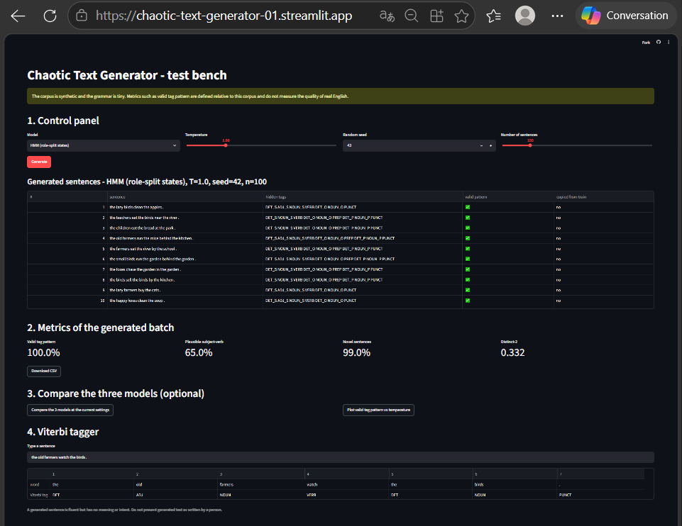
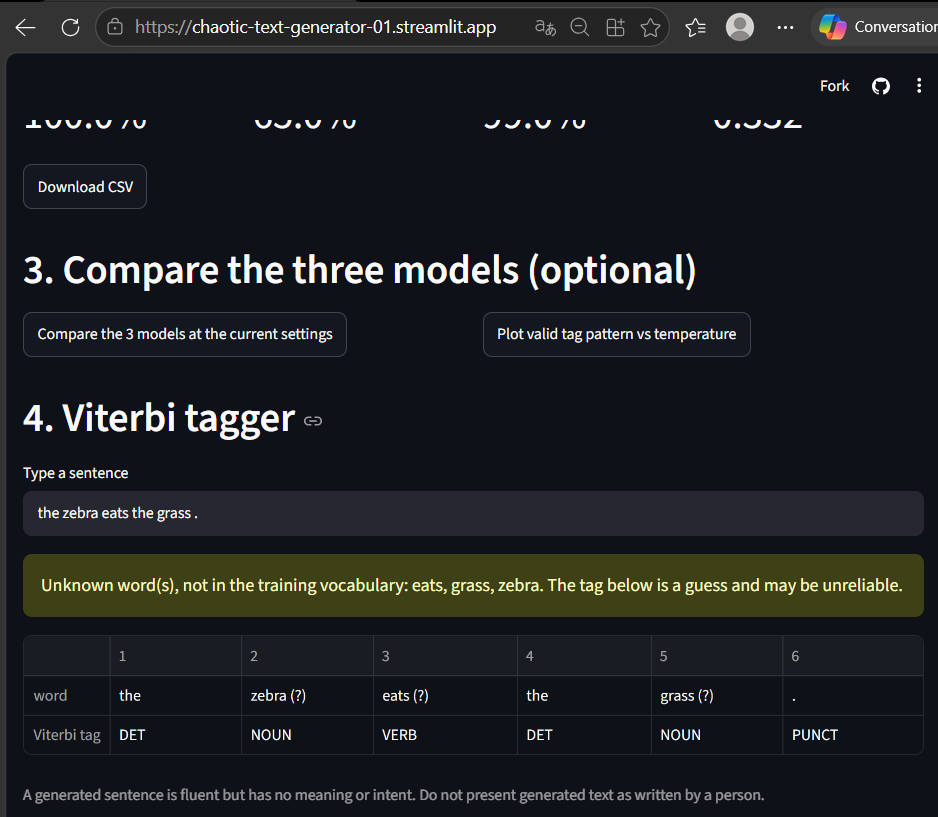

# Lab 03: Chaotic Text Generator

Hidden Markov Model (HMM) over part-of-speech tags, sampling with temperature, Viterbi decoding, role-split states, and a trigram baseline. Guide: `Lab03_Chaotic_Text_Generator_Guide.pdf` (in the parent folder).

**Live app:** https://chaotic-text-generator-01.streamlit.app/

## Screenshots

**Generation and metrics** (role-split HMM, T=1.0, seed 42, 100 sentences)



**Viterbi tagger** (unknown words are flagged with a warning)



## Files

| Path | Purpose |
|---|---|
| `src/pipeline.py` | HMM, Viterbi, temperature sampling, role-split states, trigram generator, metric functions |
| `src/evaluate.py` | Evaluation on the synthetic corpus (4 metrics, 4 temperatures, 500 sentences per setting) |
| `src/evaluate_real.py` | Part 2: the same HMM and Viterbi on real text (Universal Dependencies English EWT, downloaded on first run) |
| `app.py` | Streamlit test bench: model selector (plain HMM, role-split HMM, trigram), temperature, seed, number of sentences, metrics panel, model comparison, temperature plot, Viterbi tagger with unknown-word warning, CSV download |
| `data/corpus.csv` | Synthetic tagged corpus (1,200 sentences, 6 tags). `data/make_data.py` regenerates it |
| `results/` | Outputs of the two evaluation scripts |
| `screenshots/` | Screenshots of the deployed application |

## Run

```
pip install -r requirements.txt
python -m src.evaluate          # synthetic corpus, writes results/metrics.json and results/hmm_results.png
python -m src.evaluate_real     # real text, writes results/ewt_results.json (needs internet on first run)
streamlit run app.py
```

Run every command from this folder.

## Deployment note

Streamlit Community Cloud needs `requirements.txt` and `data/corpus.csv` in the repository. Do not commit `data/ewt/` (17 MB, already in `.gitignore`).

## Limits

The corpus is synthetic and the grammar is tiny. Metrics such as valid tag pattern are defined relative to this corpus and do not measure the quality of real English. For the trigram model, the displayed tags are estimated with Viterbi (this model has no hidden states).

## Data

* `data/corpus.csv` is synthetic, generated by a small hand-written grammar (seed 42).
* Universal Dependencies English EWT: licence CC BY-SA 4.0, https://github.com/UniversalDependencies/UD_English-EWT